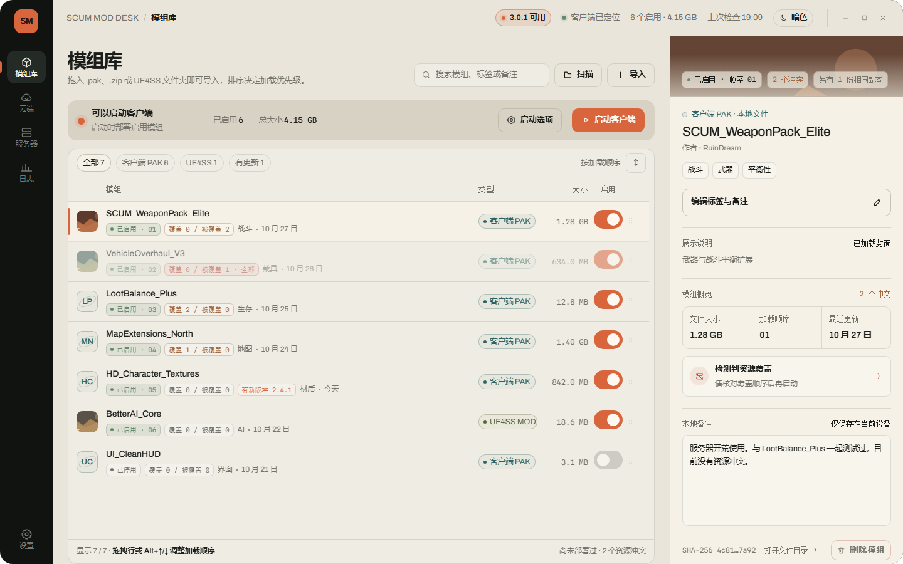
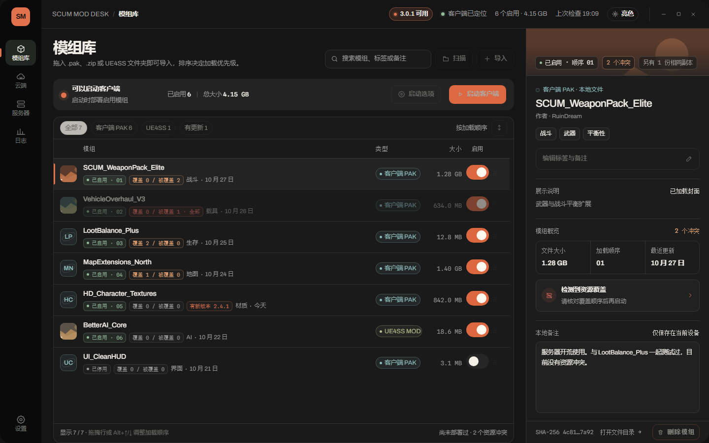
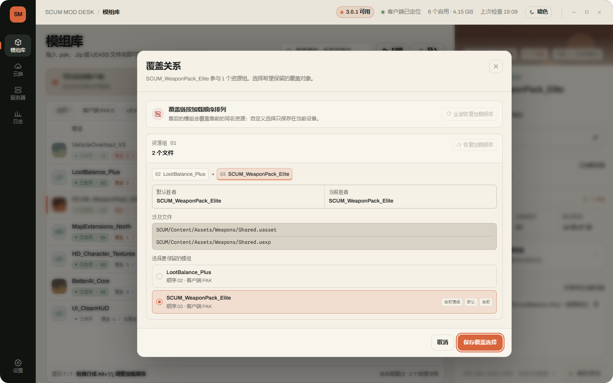
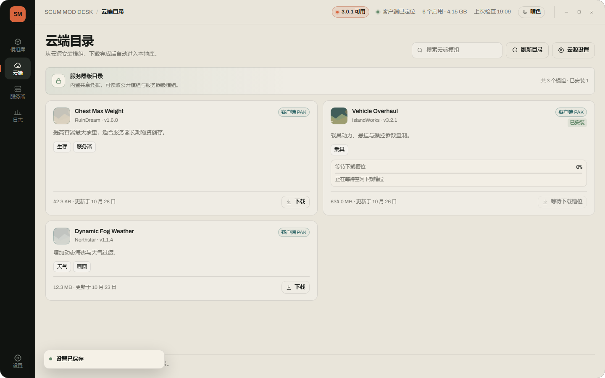
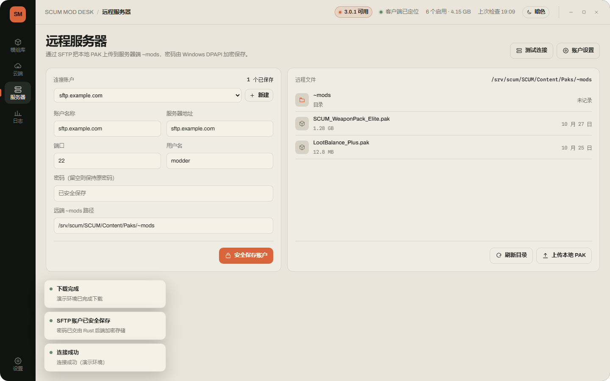
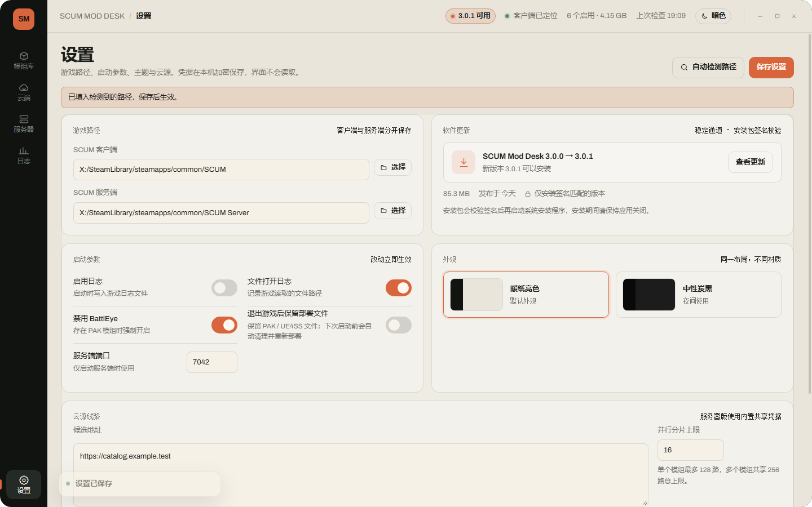

# SCUM Mod Manager FD · v3

[](https://github.com/LHuiMeng/SCUM-Mod-Manager-FD/actions/workflows/ci.yml)
[](https://github.com/LHuiMeng/SCUM-Mod-Manager-FD/releases/latest)
[](LICENSE)

《SCUM》Windows 模组管理器的 Rust/Tauri 重写版本。React + TypeScript 负责界面，
文件系统、进程、网络、云目录、SFTP 与凭据操作全部由 Rust 后端执行。

旧版 Flutter 实现已完整归档到
[`archive/flutter-v2.6.5`](https://github.com/LHuiMeng/SCUM-Mod-Manager-FD/tree/archive/flutter-v2.6.5)
分支和同名 tag；`main` 分支自 v3.0.0 起为 Rust/Tauri 架构。

## 下载

前往 [GitHub Releases](https://github.com/LHuiMeng/SCUM-Mod-Manager-FD/releases/latest)
下载 Windows x64 安装包或便携包。

程序必须安装到用户可写的非 C 盘目录，例如 `R:\SCUM Mod Desk`。不要安装到
`Program Files`；配置、模组、日志和凭据都会写入程序目录下的 `app-data/`。

## 预览

| 亮色模组库 | 暗色模组库 |
| --- | --- |
|  |  |

| 资源冲突检查 | 云端目录 |
| --- | --- |
|  |  |

| 远程服务器 | 设置 |
| --- | --- |
|  |  |

## 功能

- 扫描、导入和启用本地 `~mods/*.pak`
- 拖入同名 PAK、ZIP 内容或 UE4SS 目录时先确认覆盖，旧文件备份到 `backups/imports/`
- 读取 PAK 内部资源清单，检测已启用模组之间覆盖同一资源的冲突
- 按完整 SHA-256 合并重复 PAK，并只部署一个主条目
- 支持 PAK / UE4SS 模组封面与展示说明，模板见 `templates/mod-presentation/`
- 部署到客户端/服务端 `Paks/~mods/`，覆盖原文件前自动备份，退出后恢复并回收
- 管理 UE4SS 目录模组并同步 `mods.txt`
- 拖拽调整 PAK 加载顺序，编辑标签与本地备注，或把模组安全移入删除备份
- 从 Steam 注册表和 `libraryfolders.vdf` 检测游戏路径
- 浏览云模组目录，云目录提供 SHA-256 时强制校验，缺少时明确提示未校验
- SFTP 浏览、主机指纹确认、连接测试与服务器模组上传
- 亮色纸张主题与中性石墨暗色主题
- 简体中文 / English 界面切换，支持用户覆盖翻译文件

## 技术栈

| 层 | 技术 |
|---|---|
| UI | React 19、TypeScript、Vite |
| 桌面壳 | Tauri 2 |
| 后端 | Rust、Tokio、Reqwest、SSH2 |
| 平台集成 | Win32 / Windows DPAPI |
| 持久化 | JSON 配置、JSON 元数据、DPAPI 凭据文件 |

## 开发

前置环境：Node.js 20+、Rust stable、Visual Studio Build Tools（C++ 桌面开发）、
WebView2 Runtime。

```powershell
npm install
npm run dev          # 浏览器预览，使用内置 mock 数据
npm run tauri dev    # 启动真实 Tauri 窗口与 Rust 后端
```

常用检查：

```powershell
npm run typecheck
npm run test
npm run build
cargo test --manifest-path src-tauri/Cargo.toml
```

## 发布构建

```powershell
npm run tauri build
```

主要产物位于 `src-tauri/target/release/`，NSIS 安装器位于
`src-tauri/target/release/bundle/nsis/`。

### 便携目录包

```powershell
npm run package:portable -- -Edition public
```

便携包输出到 `release-output/portable/`。解压后将整个 `SCUM Mod Desk`
目录放到非 C 盘的可写位置，例如 `R:\SCUM Mod Desk`，再运行
`scum-mod-manager.exe`。不要放进 `Program Files`，普通用户无法在那里写入
运行数据。NSIS 安装器同样会拒绝安装到 C 盘。

### 公开发行版与服务器版

发布构建前先复制 `secrets/example.toml` 为 `secrets/runtime.toml`，并在
`[cloud].base_urls` 填写公开云目录线路。公开版只会把线路编入程序，不打包该
文件；服务器版还需要填写 `[cloud].auth_token`，然后构建：

```powershell
npm run build:editions -- -Edition public
npm run build:editions -- -Edition server
npm run build:editions -- -Edition both
```

安装器输出到 `release-output/public/` 与 `release-output/server/`。公开版不包含
`runtime.toml`，Rust 也会强制忽略共享密钥；服务器版另外把 `runtime.toml` 打入
`runtime-secrets/runtime.toml`，仅由 Rust 后端读取。

共享密钥会随服务器安装包分发，具备本机文件读取能力的人最终可以提取它。
它用于隔离普通公开客户端，不应被视为能够抵御逆向工程的绝对秘密。

## 目录

```text
src/                         React 界面
  api/                       Tauri invoke 与浏览器 mock
  components/                页面、检查器、弹窗与通用控件
  styles/tokens.css          亮色/暗色主题 token
  i18n/                      内置中英文翻译与 React i18n context
src-tauri/                   Rust/Tauri 后端
  src/state.rs               应用状态与扫描/元数据
  src/mods/                  PAK 扫描、导入与部署
  src/cloud.rs               云目录与下载校验
  src/sftp.rs                SFTP 浏览与上传
  src/secrets.rs             DPAPI 凭据保护
  resources/                 repak.exe 与 UE4SS 框架
templates/mod-presentation/  模组封面与 mod.json 展示约定
secrets/                     被 Git 隔离的本地敏感配置
```

## 运行数据

程序生成的数据统一保存在程序目录下的 `app-data/`：

```text
app-data/
  config.json
  mods_meta.json
  deployment_manifest.json
  ~mods/
  ue4ss_runtime/
  backups/deploy/
  logs/
  locales/                  用户翻译覆盖（JSON，key 可局部覆盖）
  secrets/
```

### 界面翻译

语言保存在 `config.json` 的 `language` 字段（`zh-CN` 或 `en-US`），界面切换会
立即写入 `localStorage` 并尝试持久化到配置。若配置文件写入失败，语言会回退
到切换前的值。

用户可直接编辑 `app-data/locales/zh-CN.json` 或
`app-data/locales/en-US.json`，保存后重新切换一次语言（或重启应用）即可生效，
无需重新编译。只需写需要覆盖的 key，未提供的条目会回退到内置翻译。JSON 支持
嵌套对象或扁平 key，并支持 `{name}`、`{count}` 形式的插值。
首次启动会在该目录自动补齐 README 与示例文件，已存在的用户文件不会被覆盖。

示例和完整说明见 `locales/README.md` 与 `locales/example.zh-CN.json`。
内置字典位于 `src/i18n/locales/`；运行时会向 `app-data/locales/` 补齐完整的
`zh-CN.example.json`、`en-US.example.json` 和最小覆盖示例。

Tauri 与 WebView2 的缓存也保存在该目录。程序不会再回落到
`%APPDATA%` 或 `%LOCALAPPDATA%`。升级会保留 `app-data`；便携版可直接删除
整个程序目录完成清理。

从旧版迁移 C 盘数据：

```powershell
npm run migrate:data -- -Destination "R:\SCUM Mod Desk\app-data" -Edition public
```

脚本默认不覆盖目标已有文件，也不删除旧数据。确认迁移结果后，可再次执行并
添加 `-RemoveOld` 删除旧目录。

## 敏感信息

- 仓库只跟踪 `secrets/README.md` 与 `secrets/example.toml`。
- `secrets/runtime.toml`、构建密钥和其他私密文件由 `.gitignore` 排除。
- Rust 开发环境会在应用数据目录没有配置时回退读取仓库
  `secrets/runtime.toml`，前端无法直接读取该文件。
- SFTP 密码由 Windows DPAPI 加密，写入
  `app-data/secrets/sftp/*.bin`；React 只接收 `hasPassword`，不接收密码。
- SFTP 首次连接必须核对并确认服务器主机密钥指纹，结果保存在
  `app-data/secrets/sftp_known_hosts.json`；指纹变化时连接会被拒绝。
- 运行 `npm run secrets:check` 可检查敏感文件是否被 Git 跟踪。

## 第三方资源

- [UE4SS](https://github.com/UE4SS-RE/RE-UE4SS)：UE4/UE5 脚本注入框架，MIT
- [repak](https://github.com/trumank/repak)：Unreal PAK 工具，Apache-2.0 / MIT

## 许可

MIT
