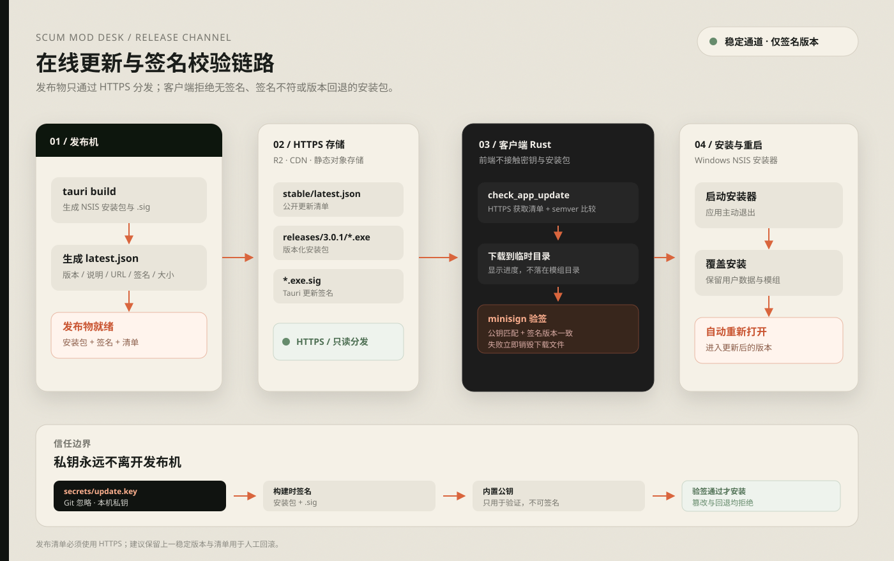

# 在线更新设计

SCUM Mod Desk 使用 Tauri 官方 updater 链路。客户端只接受同时满足以下条件的安装包：

- 更新清单通过 HTTPS 获取。
- 清单中的版本高于当前版本。
- 安装包签名与内置公钥匹配。
- 签名中的版本与清单版本一致。

普通 ZIP 覆盖、无签名下载和跳版本回退都不在允许范围内。



## 链路

1. 发布机执行正式构建，生成 NSIS 安装包和 `.sig` 签名。
2. 发布脚本生成 `latest.json`，写入版本、说明、安装包 URL、大小和签名。
3. 安装包、签名和清单上传到 HTTPS 静态存储，例如 Cloudflare R2 或对象存储 CDN。
4. 客户端设置页调用 Rust `check_app_update` 命令。
5. Rust 使用内置公钥和 HTTPS 清单检查 semver，只返回真正更新的版本。
6. 用户确认后，Rust 下载安装包到临时目录，校验签名和签名版本。
7. 校验通过后启动 NSIS 安装器；旧进程退出，安装完成后自动重新打开。

## 清单格式

```json
{
  "version": "3.0.1",
  "notes": "提高界面字号可读性并完善在线更新。",
  "pub_date": "2026-10-26T12:00:00Z",
  "platforms": {
    "windows-x86_64": {
      "signature": "<安装包 .sig 文件内容>",
      "url": "https://download.example.com/stable/3.0.1/SCUM.Mod.Desk_3.0.1_x64-setup.exe",
      "size": 89456640
    }
  }
}
```

`size` 是可选扩展字段，用于在更新弹窗中显示安装包大小。

## 本地密钥

私钥、密码和真实更新地址只放在根目录 `secrets/`，该目录除
`README.md` 与 `example.toml` 外全部被 Git 忽略。

首次生成签名密钥：

```powershell
npm run tauri -- signer generate -w secrets/update.key --ci
```

命令输出的公钥写入本地 `secrets/runtime.toml`：

```toml
[update]
endpoint = "https://download.example.com/stable/latest.json"
public_key = "RW..."
private_key_path = "secrets/update.key"
private_key_password = ""
download_base_url = "https://download.example.com/stable"
```

不要把 `runtime.toml`、`update.key` 或私钥密码写入源码、文档、测试或提交信息。

## 发布

```powershell
powershell -ExecutionPolicy Bypass -File scripts/release-update.ps1 -Notes "本次更新说明"
```

脚本会：

- 读取本地 `secrets/runtime.toml`。
- 把公钥和清单地址注入正式构建；发布版优先使用编译时固定值，避免运行时被替换。
- 使用本地私钥生成 updater 签名。
- 把安装包、签名和生成的 `latest.json` 复制到 `release-output/<version>/`。

将安装包与 `.sig` 上传到 `download_base_url/<version>/`，再把生成的
`latest.json` 上传到配置的 endpoint。安装包目录应保持不可变；发布新版本时
只替换 `latest.json`。建议保留旧安装包与旧清单，便于人工重装排障。

客户端不会自动降级。紧急回滚时，可以人工重新安装旧版，或者发布一个版本号
更高、包含修复的版本。

## 发布检查

- `latest.json` 只通过 HTTPS 提供。
- 更新地址使用版本化文件名。
- 私钥始终留在 `secrets/`，不进入安装包。
- `npm run secrets:check` 通过。
- `git check-ignore -v secrets/runtime.toml` 能命中忽略规则。
- 用上一版安装包执行一次真实的“检查 → 下载 → 验签 → 安装 → 重启”验收。
